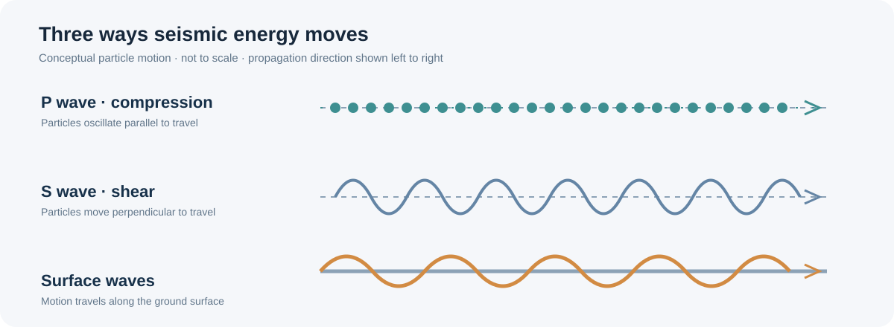

# RICHTER — Nepal Earthquake Damage Prediction

<p align="center">
  
</p>

<p align="center">
  <strong>Earthquake science · Building vulnerability · Multiclass damage prediction</strong>
</p>

<p align="center">
  
  
  
  
</p>

**RICHTER** is a reproducible machine-learning study of building damage associated with the 2015 Nepal earthquake. It uses building, geographic, and socioeconomic attributes to classify observed damage into three categories. The project connects the physical science of earthquakes with the built environment, then evaluates how well tabular machine-learning models can distinguish the recorded damage grades.

The full executed notebook is available at [Notebook/richter-earthquake-damage-prediction.ipynb](Notebook/richter-earthquake-damage-prediction.ipynb).

> **Important scope note:** Despite the project name, this model does not calculate earthquake magnitude, locate an epicenter, process seismograms, forecast earthquakes, or estimate real-time shaking. It predicts recorded building-damage categories from the supplied post-event dataset. It is a data-science research project—not a structural engineering assessment or life-safety tool.

## Results at a glance

| Evaluation | Result |
|---|---:|
| Public leaderboard micro-F1 | **0.7493** |
| Public leaderboard rank | **#480** |
| Selected blended OOF micro-F1 | **0.747640 ± 0.001730** |
| Structural-interaction LightGBM CV | **0.747578 ± 0.002072** |
| Original LightGBM CV | **0.747100 ± 0.001960** |
| Final test predictions | **86,868** |

The selected blend combined original and structural-interaction model probabilities at 40% / 60%. Its OOF improvement over the structural model alone was only 0.000062. This difference is very small and is not established as a statistically meaningful generalization gain.

<p align="center">
  
</p>

## 1. Earthquake science: from fault movement to ground shaking

An earthquake begins when stress accumulated in the Earth's crust causes rock on or near a fault to slip. The released energy travels outward from the rupture as **seismic waves**. The point inside the Earth where rupture begins is the *hypocenter* (or focus); the point directly above it on the surface is the *epicenter*.

An earthquake is not described by one simple measure of “how much a building shakes.” Seismologists distinguish the energy released by the event from the shaking experienced at a particular location.

### The main seismic wave types

<p align="center">
  
</p>

| Wave type | Motion | Typical behavior | Why it matters |
|---|---|---|---|
| **P waves** (primary) | Compressional: particles move back and forth in the direction the wave travels | Fastest seismic body waves; travel through solids and fluids | Often arrive first and can provide an early indication that an earthquake has begun |
| **S waves** (secondary) | Shear: particles move perpendicular to the direction of travel | Slower than P waves; travel through solids, not liquids | Their stronger side-to-side or up-and-down motion can impose damaging loads on structures |
| **Surface waves** | Motion travels along the Earth's surface; includes Love and Rayleigh waves | Often slower, with large amplitudes and longer-lasting motion near the surface | Can produce substantial ground movement and contribute significantly to damage, especially at some distances and site conditions |

The simplified illustrations above show particle-motion concepts, not actual wave amplitudes or a measured Nepal seismogram. Real seismic records contain overlapping wave arrivals whose characteristics depend on the source, travel path, and local geology.

### Richter magnitude is not the same as shaking intensity

The **Richter scale**, introduced by Charles F. Richter in 1935, was a local-magnitude scale originally designed for earthquakes in southern California using a particular seismograph and distance correction. Magnitude is logarithmic: an increase of one magnitude unit corresponds to ten times the recorded wave amplitude under the scale's definition. The associated energy release increases by roughly 32 times per whole magnitude unit.

For large earthquakes, modern reporting generally relies on **moment magnitude (Mw)**, which is based on seismic moment: a physical measure related to fault area, the amount of slip, and rock rigidity. Moment magnitude is more consistent across a wider range of earthquake sizes than the original local Richter scale.

**Magnitude** describes the earthquake source; **intensity** describes the observed effects and shaking at a particular place. One earthquake has a single event magnitude, but its intensity can vary from neighborhood to neighborhood. Distance from the rupture, rupture direction, depth, local soil and sediment, topography, and building characteristics all influence the shaking and damage experienced at a site.

### Why the same earthquake can damage buildings differently

The path from an earthquake to building damage is not determined by magnitude alone. Several interacting factors matter:

- **Ground motion:** amplitude, frequency content, duration, and direction of shaking influence the forces imposed on a structure.
- **Site conditions:** soft sediments and deep soil deposits can amplify or modify shaking at some frequencies. Local geology can therefore make nearby locations experience different motion.
- **Building characteristics:** height, number of floors, age, materials, design, construction quality, and structural system affect how a building responds.
- **Structural regularity and connections:** weak or discontinuous load paths, poor connections, and vulnerable ground-floor configurations can increase risk.
- **Exposure and context:** the number, location, occupancy, and use of buildings shape the consequences of an event, even though they do not change the earthquake's magnitude.

A building's response also depends on resonance: when important frequencies in ground motion are close to a structure's natural frequencies, its motion can be amplified. This is one reason that building height and structural configuration are relevant variables in damage analysis.

## 2. The 2015 Nepal earthquake and this dataset

The project uses the DrivenData competition **[Richter's Predictor: Modeling Earthquake Damage](https://www.drivendata.org/competitions/57/nepal-earthquake/)**, based on building records associated with the 2015 Gorkha (Nepal) earthquake. The modeling task is to predict the recorded building damage grade from supplied building and location attributes.

The target has three ordered categories:

- **Grade 1** — lower recorded damage category
- **Grade 2** — intermediate recorded damage category
- **Grade 3** — highest recorded damage category

These are competition target labels. They should not be interpreted as a complete engineering diagnosis, a standardized safety inspection, or a direct measurement of seismic intensity.

### Dataset dimensions

| Dataset file | Shape |
|---|---:|
| `train_values` | 260,601 × 39 |
| `train_labels` | 260,601 × 2 |
| `test_values` | 86,868 × 39 |
| `submission_format` | 86,868 × 2 |

### Target distribution

| Damage grade | Buildings | Share |
|---|---:|---:|
| Grade 1 | 25,124 | 9.64% |
| Grade 2 | 148,259 | 56.89% |
| Grade 3 | 87,218 | 33.47% |

The majority-class accuracy baseline is 56.89%. Because the competition's primary metric is micro-averaged F1, model selection and reporting focus on that metric.

### What the model observes—and what it does not

The supplied table contains building-level attributes, including structural characteristics and geographic identifiers. It does **not** provide raw P-wave or S-wave traces, accelerometer time histories, a site-specific response spectrum, or a complete engineering inspection record for every building. Consequently, this notebook does not infer wave propagation or calculate the physical shaking experienced by each structure.

Instead, it learns statistical relationships between the available building/location features and the damage grades in the training labels. The earthquake-science discussion provides context for why structural and site-related variables can matter; it does not mean that the model directly measures those physical mechanisms.

## 3. Analysis workflow

<p align="center">
  
</p>

1. **Data audit** — inspect dimensions, identifiers, target distribution, missingness, and duplicate records.
2. **Geographic and structural exploration** — examine recorded damage patterns across building characteristics and geographic levels.
3. **Feature engineering** — create age, building geometry, floor, and structural-system features.
4. **Model comparison** — evaluate original and structural-interaction LightGBM candidates; screen saved CatBoost, LightGBM, and XGBoost OOF predictions without retraining.
5. **Cross-validation** — use five-fold out-of-fold evaluation to compare candidate LightGBM configurations.
6. **Probability blending** — compare original and structural-interaction predictions using OOF probabilities.
7. **Submission audit** — verify schema, row count, identifier uniqueness and order, valid classes, missing values, and prediction consistency.

## 4. Feature engineering

The engineered features capture building age, scale, vertical structure, and combinations of structural attributes.

**Derived building features**
- `age_log1p`, `age_group`
- `height_per_floor`, `area_per_floor`, `height_area_ratio`
- `superstructure_count`, `secondary_use_count`
- `is_multi_story`, `is_old_building`

**Structural interactions**
- `foundation_ground_floor`
- `roof_ground_floor`
- `age_foundation`
- `floors_x_height`
- `age_x_superstructure`
- `age_x_floors`

These are predictive feature constructions, not direct measurements of structural capacity or code compliance. The original LightGBM experiment used 47 features. The structural-interaction version used 53 features.

## 5. Model evaluation

| Model | Feature count | CV micro-F1 |
|---|---:|---:|
| Original LightGBM | 47 | 0.747100 ± 0.001960 |
| Structural-interaction LightGBM | 53 | 0.747578 ± 0.002072 |
| 40% original + 60% structural blend | — | **0.747640 ± 0.001730** |

The selected blend's out-of-fold classification report:

| Grade | Precision | Recall | F1 | Support |
|---|---:|---:|---:|---:|
| 1 | 0.6754 | 0.5563 | 0.6101 | 20,099 |
| 2 | 0.7518 | 0.8414 | 0.7941 | 118,607 |
| 3 | 0.7585 | 0.6433 | 0.6962 | 69,774 |

Grade 2 is the strongest class by F1, while Grade 1 has the lowest recall. This class-level view matters: a single aggregate score can conceal uneven performance across damage categories.

## 6. Validation and submission integrity

The final three candidate submissions—original, structural-interaction, and blended—passed the recorded integrity checks:

- Expected submission schema and column names
- Exactly 86,868 test rows
- Unique identifiers and preserved test identifier order
- Valid damage-grade labels
- No missing predictions
- Probability array shape and row-wise probability sums
- Predicted classes consistent with the corresponding probability outputs

The project also audited saved experiment artifacts and recovered the expected section outputs after an initial packaging audit identified a missing Section 08 artifact group.

## 7. Experiments not selected

Several alternatives were tested but did not outperform the selected approach in the available validation:

| Experiment | CV micro-F1 |
|---|---:|
| Geographic target encoding | 0.746355 |
| Higher-complexity configuration | 0.747376 |
| Regularized configuration | 0.747108 |
| Threshold tuning | 0.747563 |

These experiments are retained as comparisons, not evidence that the selected model is universally optimal.

## 8. Limitations and responsible interpretation

- The blend weight was selected using the available OOF results; the reported blend score may therefore be optimistic.
- The threshold experiment was not evaluated through a fully independent nested validation design.
- The small OOF difference between the blend and structural model is not established as statistically meaningful.
- Geographic and socioeconomic associations are predictive signals in this dataset, not causal explanations.
- The data and labels reflect a particular earthquake, place, collection process, and period. Performance may not transfer to other regions or events.
- The model does not ingest seismic waveforms or measured ground acceleration, and it does not estimate magnitude, intensity, or future earthquake occurrence.
- A predicted grade is not a substitute for on-site inspection by qualified structural and geotechnical professionals. Never use this model to determine whether a real building is safe to occupy, repair, or demolish.

## 9. Reproducibility

The analysis was developed in a Kaggle notebook environment using Python and common tabular machine-learning libraries, including pandas, NumPy, and LightGBM. The experiment uses a fixed random seed of 42 and five-fold cross-validation for the reported model comparisons.

To reproduce the work, open the [executed notebook](Notebook/richter-earthquake-damage-prediction.ipynb) in Kaggle or a compatible Jupyter environment. The setup cell downloads the four CSVs from this repository's `Dataset/` directory and installs any missing model libraries; network access is therefore required for a clean run. The notebook uses Python 3.13.18 metadata and a fixed random seed of 42. Run the sections in order so that saved OOF and checkpoint artifacts are available to later sections.

**Dataset rights:** Competition CSVs are present under `Dataset/` for this project's workflow. Their presence in this repository does not grant broader redistribution rights. Check the competition's terms and the original data license before reuse or redistribution. The repository's MIT license applies to project code and documentation, not automatically to third-party competition data.

## Repository structure

```text
.
├── README.md
├── Notebook/
│   └── richter-earthquake-damage-prediction.ipynb
└── assets/
    ├── retrospective-banner.svg
    ├── model-results.svg
    ├── workflow.svg
    └── seismic-waves.svg
```

## Acknowledgements

- DrivenData for the **Richter's Predictor: Modeling Earthquake Damage** challenge and dataset.
- The data contributors and researchers whose work made the building-level records available.
- The seismology and earthquake-engineering community whose research explains how seismic waves, site conditions, and structural response interact.

---

<p align="center">
  <sub>RICHTER · Connecting earthquake science, building vulnerability, and reproducible machine learning</sub>
</p>
