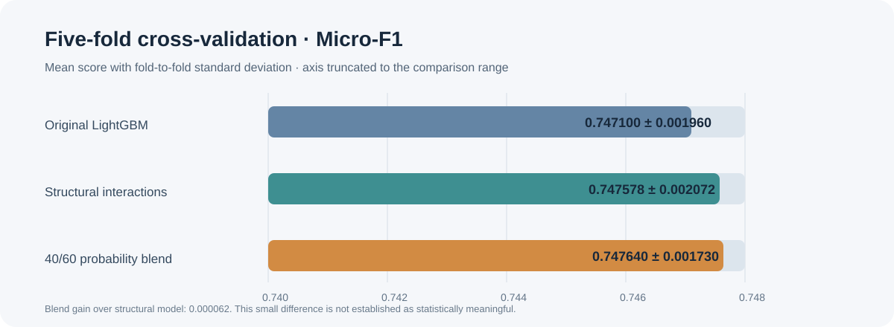
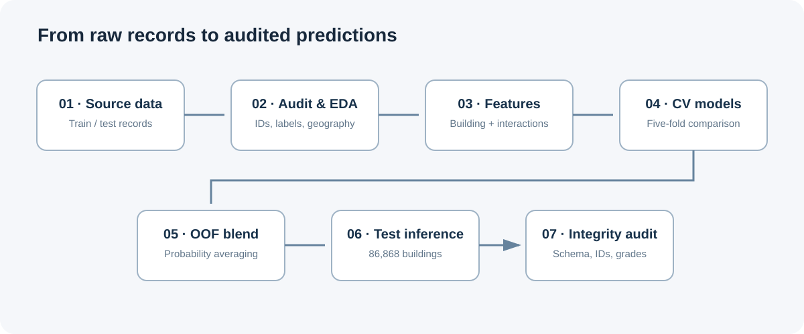

# RICHTER — Nepal Earthquake Damage Prediction

<p align="center">
  
</p>

<p align="center">
  <strong>Multiclass building-damage prediction · Model validation · Structural feature engineering</strong>
</p>

<p align="center">
  
  
  
  
</p>

**RICHTER** is a reproducible machine-learning study of building damage from the 2015 Nepal earthquake. It uses structural, geographic, and socioeconomic building attributes to classify damage into three ordinal categories. The work emphasizes careful validation, interpretable feature construction, out-of-fold (OOF) evaluation, and submission integrity—not just leaderboard optimization.

> **Scope note:** This is a data-science research project. Its predictions are not engineering assessments, building inspections, or a life-safety decision tool.

## Results at a glance

| Evaluation | Result |
|---|---:|
| Public leaderboard micro-F1 | **0.7493** |
| Public leaderboard rank | **#480** |
| Selected blended OOF micro-F1 | **0.747640 ± 0.001730** |
| Structural-interaction LightGBM CV | **0.747578 ± 0.002072** |
| Original LightGBM CV | **0.747100 ± 0.001960** |
| Final test predictions | **86,868** |

The blend combined original and structural-interaction model probabilities at 40% / 60%. Its OOF improvement over the structural model alone was only 0.000062; that difference is small and should not be interpreted as established evidence of a meaningful generalization gain.

<p align="center">
  
</p>

## Problem and data

The project uses the DrivenData competition **Richter's Predictor: Modeling Earthquake Damage**. The prediction target is the building damage grade recorded after the 2015 Nepal earthquake:

- **Grade 1** — lower damage category
- **Grade 2** — intermediate damage category
- **Grade 3** — highest damage category

The supplied training data contains 260,601 buildings and the test set contains 86,868 buildings.

| Dataset file | Shape |
|---|---:|
| `train_values` | 260,601 × 39 |
| `train_labels` | 260,601 × 2 |
| `test_values` | 86,868 × 39 |
| `submission_format` | 86,868 × 2 |

### Target distribution

| Damage grade | Buildings | Share |
|---|---:|---:|
| Grade 1 | 25,124 | 9.64% |
| Grade 2 | 148,259 | 56.89% |
| Grade 3 | 87,218 | 33.47% |

The majority-class accuracy baseline is 56.89%. Because the competition's primary metric is micro-averaged F1, model selection and reporting focus on that metric.

## Workflow

<p align="center">
  
</p>

1. **Data audit** — inspect dimensions, identifiers, target distribution, missingness, and duplicate records.
2. **Geographic and structural exploration** — examine damage patterns across building characteristics and geographic levels.
3. **Feature engineering** — create age, building geometry, floor, and structural-system features.
4. **Model comparison** — evaluate traditional, movement/structural, and combined feature sets where applicable to the experiment.
5. **Cross-validation** — use five-fold out-of-fold evaluation to compare candidate LightGBM configurations.
6. **Probability blending** — compare original and structural-interaction predictions using OOF probabilities.
7. **Submission audit** — verify schema, row count, identifier uniqueness and order, valid classes, missing values, and prediction consistency.

## Feature engineering

The engineered features capture building age, scale, vertical structure, and combinations of structural attributes.

**Derived building features**
- `age_log1p`, `age_group`
- `height_per_floor`, `area_per_floor`, `height_area_ratio`
- `superstructure_count`, `secondary_use_count`
- `is_multi_story`, `is_old_building`

**Structural interactions**
- `foundation_ground_floor`
- `roof_ground_floor`
- `age_foundation`
- `floors_x_height`
- `age_x_superstructure`
- `age_x_floors`

The original LightGBM experiment used 47 features. The structural-interaction version used 53 features.

## Model evaluation

| Model | Feature count | CV micro-F1 |
|---|---:|---:|
| Original LightGBM | 47 | 0.747100 ± 0.001960 |
| Structural-interaction LightGBM | 53 | 0.747578 ± 0.002072 |
| 40% original + 60% structural blend | — | **0.747640 ± 0.001730** |

The selected blend's out-of-fold classification report:

| Grade | Precision | Recall | F1 | Support |
|---|---:|---:|---:|---:|
| 1 | 0.6754 | 0.5563 | 0.6101 | 20,099 |
| 2 | 0.7518 | 0.8414 | 0.7941 | 118,607 |
| 3 | 0.7585 | 0.6433 | 0.6962 | 69,774 |

Grade 2 is the strongest class by F1, while Grade 1 has the lowest recall. This class-level view matters: a single aggregate score can conceal uneven performance across damage categories.

## Validation and submission integrity

The final three candidate submissions—original, structural-interaction, and blended—passed the recorded integrity checks:

- Expected submission schema and column names
- Exactly 86,868 test rows
- Unique identifiers and preserved test identifier order
- Valid damage-grade labels
- No missing predictions
- Probability array shape and row-wise probability sums
- Predicted classes consistent with the corresponding probability outputs

The project also audited saved experiment artifacts and recovered the expected section outputs after an initial packaging audit identified a missing Section 08 artifact group.

## Experiments not selected

Several alternatives were tested but did not outperform the selected approach in the available validation:

| Experiment | CV micro-F1 |
|---|---:|
| Geographic target encoding | 0.746355 |
| Higher-complexity configuration | 0.747376 |
| Regularized configuration | 0.747108 |
| Threshold tuning | 0.747563 |

These experiments are retained as comparisons, not evidence that the selected model is universally optimal.

## Limitations and responsible interpretation

- The blend weight was selected using the available OOF results; the reported blend score may therefore be optimistic.
- The threshold experiment was not evaluated through a fully independent nested validation design.
- The small OOF difference between the blend and structural model is not established as statistically meaningful.
- Geographic and socioeconomic associations are predictive signals in this dataset, not causal explanations.
- The data and labels reflect a particular earthquake, place, collection process, and period. Performance may not transfer to other regions or events.
- This model must not be used to determine whether a real building is safe to occupy, repair, or demolish.

## Reproducibility

The analysis was developed in a Kaggle notebook environment using Python and common tabular machine-learning libraries, including pandas, NumPy, and LightGBM. The experiment uses a fixed random seed of 42 and five-fold cross-validation for the reported model comparisons.

To reproduce the work, obtain the competition data through the official DrivenData competition, place the files in the notebook's expected input location, and run the notebook sections in order. Competition data is not redistributed in this repository.

## Repository structure

```text
.
├── README.md
└── assets/
    ├── retrospective-banner.svg
    ├── model-results.svg
    └── workflow.svg
```

## Acknowledgements

- DrivenData for the **Richter's Predictor: Modeling Earthquake Damage** challenge and dataset.
- The data contributors and researchers whose work made the building-level records available.

---

<p align="center">
  <sub>RICHTER · Earthquake damage prediction as a reproducible data-science workflow</sub>
</p>
